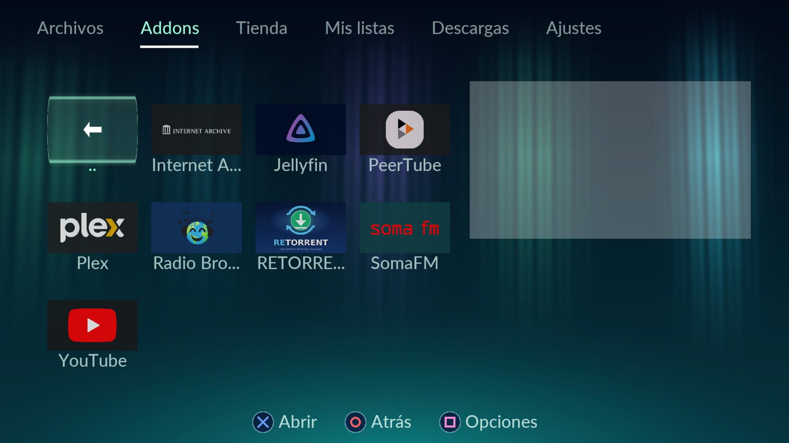
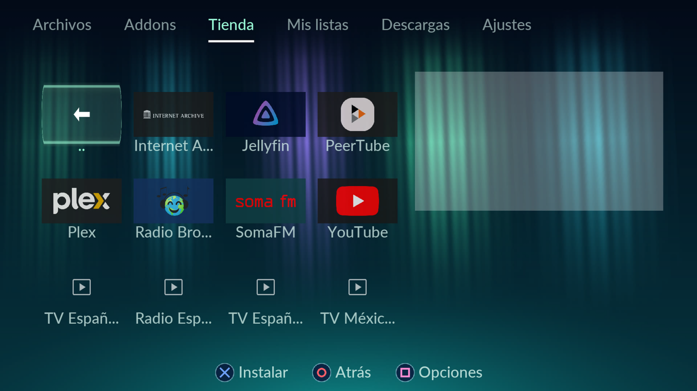
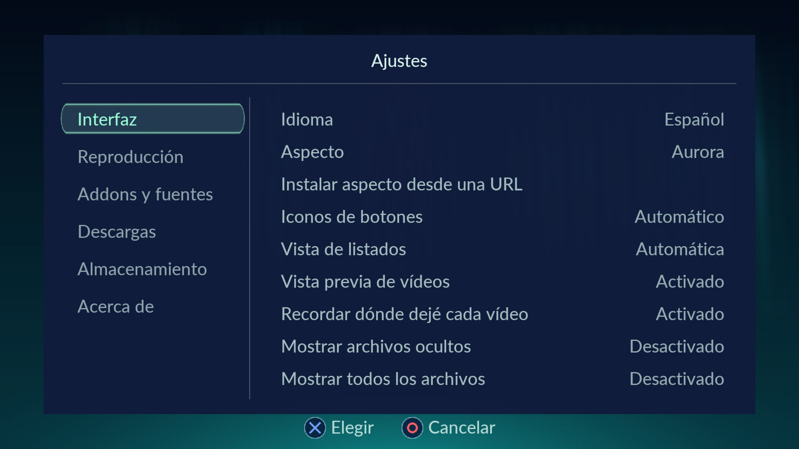

# BennuGD2 Media Player

A media player written entirely in [BennuGD2](https://github.com/SplinterGU/BennuGD2) (`.prg`), for **PlayStation 5**, **Nintendo Switch**, **Linux**, **Windows** and **Android**.
Interface drawn at 1080p with a PlayStation-style skin, designed to be driven with a gamepad.

*Reproductor multimedia escrito íntegramente en BennuGD2, para PS5, Nintendo Switch, Linux, Windows y Android. Interfaz a 1080p con aspecto estilo PlayStation, pensada para mando.* (Spanish notes at the end.)

## Screenshots

Captured on a PS5 (1.2.2, *Aurora* skin) / Capturas en una PS5 (1.2.2, aspecto *Aurora*):

| Addons | Store / Tienda |
|---|---|
|  |  |



## Features

- File explorer with **preview** (a random frame, duration, resolution, audio/subtitle tracks), icons and folders
- Video, **music mode with visualizer** (spectrum / waveform), cover art
- **File manager**: copy, move, delete, rename, new folder, mark several items and properties from the options menu (square) > Files, with a progress bar and cancel; it never overwrites (a free name like `video (2).mp4` is used). Settings can show hidden files and all file types
- **Image viewer and slideshow**: open photos (jpg, png, bmp, gif, tga) from the file browser; photos taken with the phone are turned the right way up (EXIF); zoom and pan, rotate, and a slideshow every 3 to 60 seconds with fade, slide, slow zoom or random transitions, in normal or shuffled order
- **Torrents**: the player can play a magnet link or a .torrent (from a folder, an address or an addon) while it downloads, with its own BitTorrent engine (no DHT yet). The example addon RETORRENT (`addons/torrents`) lists the .torrent files you keep on the console and plays magnet links you paste; it is not in the Store index. Addons can now show buttons, checks, choices and text fields, read folders (`list_files()`) and read web pages (`magnets()`, `links()`...)
- **Receive files from your PC**: Files > options > *Receive files from the PC* shows an address and a PIN; open it in the browser of your PC or phone and drop the files there (no FTP program needed). Nothing is overwritten
- **6 animated skins** (PlayStation, Aurora, Sunset, Neon, Embers, Cosmos) with their own fonts and colours, and **your own skins**: a folder with a `skin.cfg` and some PNG images, made on a PC and copied to the console or installed from a URL (see [SKINS.md](SKINS.md); template in `skin_template/`)
- **Subtitles** (embedded + external `.srt`), **multiple audio tracks**, seeking, volume
- **Streaming URLs**, `.m3u` / `.m3u8` lists with logos, list editor with an on-screen keyboard
- **6 UI languages** with TrueType fonts: Spanish, English, Russian, Japanese, Chinese, Korean
- **Addons** written in a small English-like language, no compiler needed (see [ADDONS.md](ADDONS.md)):
  Plex (free ad-supported catalogue + your own server, login by code), Jellyfin (your own server, or the official public demo), Radio Browser, SomaFM, Internet Archive,
  PeerTube (federated video network), YouTube (popular videos, search of videos, channels and playlists)
- **Store**: installs and updates the addons, and downloads free TV/radio lists (TDTChannels, iptv-org...), from the official repository in the app itself (no FTP, no PC)
- **Hardware video decoding on PC**: on Linux and Windows the player uses the system's GPU decoder
  (NVDEC on NVIDIA, VAAPI on Intel/AMD, D3D11VA on Windows) instead of decoding in software; the PS5
  keeps using the console's own decoder
- Credits screen (Options → Settings → About)

## Download

See the [Releases](../../releases) page:

- **PS5 (title folder for ShadowMount+)**: `BennuGD2-Media-Player-PPSA00090-ShadowMount.zip` — copy the `PPSA00090` folder to `/data/homebrew/`, `eboot.bin` last
- **PS5 (package)**: `UP9000-PPSA00090_00-BENNUMEDIAPLAYER.pkg` (title id PPSA00090)
- **Linux x86-64**: `bennugd2-media-player-linux-x86_64.tar.gz` (needs FFmpeg, SDL2, FreeType and OpenSSL libraries, see its README)
- **Windows x86-64**: `bennugd2-media-player-windows-x86_64.zip` (self-contained; tested under Wine, not yet on a real Windows machine)

## PS5 requirements

Tested on firmware 9.00 with etaHEN and ShadowMount+ v1.7-beta5fix1 (kstuff active). The payloads used are in [`payloads.zip`](payloads.zip) (`kstuff.elf`, `a53_ppr_install_fast.elf`). With etaHEN running, the app asks it to leave the sandbox
(it writes its PID to `/download0/etahen_jailbreak`) so it can browse the whole system; without etaHEN it still runs, sandboxed (own folder and `/data/mediaplayer` only).
If the app does not open: check the firmware, that kstuff is loaded before ShadowMount+, copy `eboot.bin` last, and change the title id if a failed launch left it registered with error `0x80020008`.

## System keyboard (PS5)

On the PS5 the player uses the console's own system dialogs: the on-screen keyboard and the progress bar (not reachable from a title on the consoles tested: `SYSTEM_PROGRESS_OPEN` answers -6 there, so the player draws its own progress window instead, for downloads and Store installs). On the PS5 it opens the console's own on-screen keyboard (`libSceImeDialog`) whenever it needs text, and falls back to its built-in keyboard if the system one is not available. It needs `engine/libmod_misc-system-dialogs.patch` (functions `SYSTEM_KEYBOARD_*` and `SYSTEM_PROGRESS_OPEN/SET/MESSAGE/UPDATE/CLOSE`) and the `libSceCommonDialog` link stub (`ps5/tools/build-commondialog-stub.sh`). Downloads run in the background with `HTTP_FETCH_BEGIN/POLL` and `HTTP_PROGRESS/TOTAL` (`engine/libmod_video-async-http.patch`, on top of `libmod_video-mediaplayer.patch`; both are already committed in the author's engine fork, branch `ps5`). The same engine patch adds `VIDEO_DOWNLOAD_BEGIN/POLL/PERCENT/CANCEL/ERROR`, which saves a video from an addon (video + audio, HLS included) as an `.mp4` without re-encoding, in a background thread; `VIDEO_DOWNLOAD_CONVERT_BEGIN(source, headers, path, format)` decodes and re-encodes the audio as mp3, opus, flac, wav or aac (the encoders must be in the FFmpeg build), and `VIDEO_DOWNLOAD_AUDIO_BEGIN` / `VIDEO_DOWNLOAD_PATH` save only the audio (the container follows the codec: .m4a, .mp3, .opus, .oga, .flac). The player offers **Download** in the options menu of an addon video (a menu then asks for the format: video + audio, the original audio, or the audio converted to MP3 / Opus / FLAC / WAV / AAC), shows its own progress window (name, real percentage and a Cancel button: Circle / back, or a tap on the phone), and keeps the files in the **Downloads** folder of the home screen (options menu → *Delete download*). Each step is logged to `/data/ime.log` on the console. On PC, `MP_FAKE_SYSKB="text"` and `MP_FAKE_PROGRESS=1` simulate them for testing.

## Controls

| Gamepad | Keyboard | Action |
|---|---|---|
| D-pad / stick | arrows | move |
| ✕ | Enter | open / choose |
| ○ | Esc / Backspace | back / cancel |
| □ | M | options (browser) / mute (player) |
| △ | S | subtitles |
| Start | Space | pause |
| L1 / R1 | N / P | -10 s / +10 s (player); previous / next section (home) |
| Touchpad | A | next audio track |

**On a PC** the mouse works everywhere: moving over a row selects it, a click opens it (also the tabs, menus, settings and the on-screen keyboard), the wheel scrolls the lists and, while playing, changes the volume; in the player a click on the progress bar jumps there (drag to scrub), a click on the picture pauses, a double click toggles full screen and a right click pauses. The keyboard also works in the player: Left / Right skip (hold to go faster, Shift = x6), Page Up / Page Down skip a minute, Home goes to the start, Up / Down change the volume, M mutes (a speaker icon stays in the corner while muted) and F11 toggles full screen. In the on-screen keyboard you can simply type with the physical keyboard (Backspace deletes, Enter accepts). *Settings → Interface → Window* chooses a normal window, a borderless one (applied on the next start) or full screen.

The home screen has a menu bar on top, like Kodi's: **Files, Addons, Store, My lists, Downloads**. Press up on the first row to put the focus on the bar, then left / right changes the section and down (or ✕) goes back to the list; L1 / R1 change the section from any row, and a tap on the phone or TV works too. The options menu and the other menus are centred windows over the dimmed screen. The backgrounds (skins) are not affected.

**Settings** (the last item of the bar, or options → Settings) is a full page like Kodi's: categories on the left, their options on the right. Left / right (or ✕) changes a switch or a choice, and a text option opens the keyboard. It has: *Interface* (language, appearance, video preview), *Playback* (skip length, music visualiser), *Addons and sources* (unknown sources, install an addon from an address, store address, list accounts), *Downloads* (default format, open the folder), *Storage* (data folder, clear the image cache) and *About*. **Unknown sources** is off by default: while it is on you can install an addon that is not in the Store by typing the address of its `main.addon` (or of its folder, with an optional `logo.png` and `lang/<code>.txt` next to it), and point the player at another store. Install only addons you trust: an addon can connect to any server.

On Android the app turns the finger gestures into the keys the player already knows:

| Gesture | Action |
|---|---|
| tap on a file or folder | open it |
| swipe up / down | move in the list |
| swipe left / right | move in the menus |
| long press | options |
| the system back button | back (the engine maps it to ESC) |

## Network servers, resume list, playback options

- **Network servers** (home screen, second row): the player looks for DLNA / UPnP media servers on the local network (Plex, Jellyfin, Kodi, MiniDLNA, a router with a USB disk, a NAS...) and lets you browse their folders and play their files. You can also add **WebDAV** (`http://` / `https://`) and **FTP** (`ftp://`) servers with *Add a WebDAV / FTP server...* (address, user, password; kept in `netservers.cfg` in the data folder, in plain text like the list accounts; options menu on a server to remove it). Nothing is ever written to those servers.
- **Continue watching** (home screen): the last videos left halfway, most recent first.
- **Send a link from your phone**: the page that receives files from the PC (*Files > Receive files from the PC*) also has a box to paste a link (`http`, `https` or `magnet:`) that is opened on the console.
- **Playback options** (key `O`, R3 on the gamepad): speed (`,` / `.` keys or L2 / R2, 0.5x to 2x; the sound follows it, pitch included), subtitle delay (`[` / `]`), sound / picture sync (`;` / `'`), audio track, subtitles, repeat (list / this video) and shuffle. Files with chapters show the chapter next to the title and Page Up / Page Down jump between them.
- **New version notice**: on start (can be turned off in *Settings > About*) the player asks GitHub for the latest release and tells you if there is a newer one. It only tells you; it downloads nothing.

## Nintendo Switch (experimental)

`./build_switch.sh` builds the engine for the Switch with devkitPro (`./build.sh switch` in the engine, branch `ps5`) and packs
`mediaplayer.nro` with the `.dcb`, resources, languages, skins and addons in its romfs. Data goes to `sdmc:/switch/mediaplayer/`.
Tested only in the Eden emulator. FFmpeg for the Switch is rebuilt with https/mbedTLS (recipe in `vendor/switch/ffmpeg` of the engine) and is GPLv3.
To get a network trace create an empty `ffmpeg.debug` in `sdmc:/switch/mediaplayer/`.

## Android

The app is built from the SDL2 template in [`android/`](android). It runs on phones and tablets
(arm64-v8a, and armeabi-v7a for 32-bit devices) and on the emulator (x86_64); the APK is universal.
Text is typed in Android's own text dialog (the phone's or the TV's keyboard, with a password mode),
opened by the engine through JNI (`SYSTEM_KEYBOARD_*`, see `libmod_misc`).

### Android TV

The same APK installs on an Android TV: it declares the leanback launcher and a banner, and it does not
need a touchscreen. The remote control (arrows, OK, back) and game controllers work as they do on the
PS5 pad. Things to keep in mind on a TV: video is decoded in software with FFmpeg, so a weak TV box can
stutter at 1080p; and access to local files is more restricted than on a phone, so the network addons
(Jellyfin, Plex, YouTube...) are the most practical content there.

To build it you need the engine compiled for Android and the third-party libraries
(SDL2, SDL2_image, SDL2_mixer, FreeType, sdl-gpu, FFmpeg and mbedTLS for HTTPS):

```sh
# en el checkout de BennuGD2
ANDROID_NDK=$HOME/Android/Sdk/ndk/27.0.12077973 ./build.sh aarch64-linux-android
ANDROID_NDK=$HOME/Android/Sdk/ndk/27.0.12077973 ./build.sh x86_64-linux-android
ANDROID_NDK=$HOME/Android/Sdk/ndk/27.0.12077973 ./build.sh armv7a-linux-androideabi   # 32-bit devices (many TVs)

# en este repositorio: copia las librerias y el .dcb a donde el Gradle los espera
./android/preparar.sh

# y monta el APK
cd android && ./gradlew assembleDebug
```

The APK lands in `android/app/build/outputs/apk/debug/app-debug.apk`. It asks for access to
all the files (so it can read the videos and the music of the phone) and opens `/sdcard`.
The app tells the engine the real size of the screen (`SCALE_RESOLUTION`), so the image
fills the 16:9 box of the phone instead of staying in a corner.

## Run from source (Linux)

You need BennuGD2 built with the **`libmod_video` changes** in [`engine/libmod_video-mediaplayer.patch`](engine/libmod_video-mediaplayer.patch)
(audio tracks, audio-only/cover/spectrum, network timeouts, `HTTP_FETCH`/`HTTP_READ`/`HTTP_WRITE`… for the addons, HLS fixes).
Then:

```sh
BGD=/path/to/BennuGD2/build/linux-gnu/bin ./run.sh      # compiles mediaplayer.prg and runs it
```

PS5 build (needs the `ps5` branch of the engine): `./build_ps5.sh`.
Windows build: `engine/build_windows.sh` (mingw-w64 cross build; also needs `engine/cmake-skip-modules.patch`).

Useful variables: `MEDIA_DIR=/folder` (start folder), `MP_STORE=/folder` (where lists, settings and addon data are stored).

## Addons

Drop a folder with a `main.addon` file into `<store>/addons/` (on the PS5: `/data/mediaplayer/addons/`). Press □ on an addon for its settings.
Tokens and passwords are entered by each user in the settings, never written in the script.
Tutorial: [ADDONS.md](ADDONS.md) · [ADDONS.es.md](ADDONS.es.md).

An addon installed by hand (or downloaded from the **Store** in the main menu) is listed while the one that comes with the
player keeps its own folder: if both have the same folder name, the one in `<store>/addons/` wins, so installing from the
Store also updates the addons that ship with the player.

## Store

The **Store** row of the main menu downloads the addons from the [official repository](https://github.com/Rufidj/bennugd2-media-player)
(`addons/index.txt` + each addon folder). ✕ installs or updates the selected addon, ○ goes back and □ opens a small menu
(refresh the list). Every addon is shown with its state (`Installed`, `Update available`, `Not installed`). Addons are
plain text files, so nothing is executed while downloading; the list is left cached to show it when there is no connection.
Set `MP_STORE_URL` to another URL to use a mirror or a fork.

Besides the addons, the Store offers **free TV and radio lists** (TDTChannels, iptv-org...) taken from `addons/lists.txt`
(one line per list: `name | url | description`): ✕ downloads the list to "My lists" (`<store>/listas/`), where it can be
played at once, and pressing ✕ again downloads it again to refresh it. `tools/check_store_lists.py` checks that file
(and that every source still answers).

A list can also ask for an **account**: with a fourth field in the catalogue (`mode=basic` or `mode=form;login=...`) the
player asks for the user and the password when the list is installed, keeps them next to the list (`<store>/listas/<list>.auth`)
and uses them to download it and to play its channels. Any list can have an account too (options of a list: *Account for this
list*), and they are all listed in *Settings > Accounts*. The credentials are kept in plain text in the player's storage folder.

With `mode=xtream` the player talks to an IPTV panel that uses the **Xtream Codes API**: it asks for the server, the user and
the password, and shows the panel's own tree (live TV, movies and series by category). The tree is drawn as a 4 x 3 grid of
cards, and the channel you are on plays silently in the side panel as a moving thumbnail. The channels are played with the URLs
the panel expects (`<server>/live/<user>/<pass>/<id>.ts`).

Addons go to the first folder the player can really write to: `/data/mediaplayer` on the PS5 and
`mediaplayer_data` next to the player on the PC (it is created the first time). `MP_STORE=/folder` forces another one.

### Trying the accounts without paying for anything

`tools/test_server.py` is a small HTTP server that fakes an IPTV provider: a list that asks for a user and a password
(HTTP Basic), another one that logs in with a form and returns a token, and a panel that speaks the Xtream Codes API
(categories, live channels, movies and series). It also serves its own Store catalogue with those three lists.

```sh
python3 tools/test_server.py                  # en 127.0.0.1:8310
MP_STORE_URL=http://127.0.0.1:8310/addons ./mediaplayer.sh
```

In the Store, install *TV de pago (prueba)*, *TV de pago (formulario)* or *Xtream (prueba)*; the user is `usuario1` and the
password `clave-secreta`. To try it on the PS5, give the PC's address: `python3 tools/test_server.py 8310 192.168.1.50`.

## Credits

Created by Rufidj and Claude. Thanks to SplinterGU for BennuGD2, to Panreyes for the TTF implementation, and to FFmpeg, SDL, sdl-gpu,
FreeType, Google Noto fonts, OpenSSL, Plex, Jellyfin, SomaFM, Radio Browser, Internet Archive, PeerTube/Framasoft, YouTube, TDTChannels,
iptv-org and the PS5 homebrew community.

## License

MIT for the player code (see [LICENSE](LICENSE)). Third-party components keep their own licenses (BennuGD2, FFmpeg, SDL, FreeType, OpenSSL, Noto fonts: SIL OFL).
Plex, Jellyfin, SomaFM, Radio Browser, Internet Archive, PeerTube and YouTube are trademarks/services of their owners; the addons only use their public APIs. The addon logos are the official ones (see `addons/LOGOS.md` for their sources); they belong to their owners and are not under this project's MIT licence. The TV/radio lists of the Store belong to their authors (TDTChannels, iptv-org) and each channel is streamed from its own source. DRM-protected content is not supported.

---

### Notas en español

- Descarga el `.pkg` para PS5 o el `.tar.gz` para Linux en *Releases*.
- La **Tienda** (menú principal) instala y actualiza los addons y descarga listas de TV/radio gratis (TDTChannels, iptv-org...) a "Mis listas": X instala, ○ vuelve y cuadrado abre el menú (actualizar la lista).
- Las listas de pago se pueden usar: al instalarlas el reproductor pide el usuario y la contraseña, los guarda junto a la lista (`<almacen>/listas/<lista>.auth`) y los usa para bajarla y reproducir sus canales. También se pueden poner a mano (opciones de una lista: *Cuenta de esta lista*) y se ven en *Ajustes > Cuentas*. Ojo: se guardan en texto plano en el almacén del reproductor.
- Los paneles IPTV con la API de Xtream Codes se muestran en cuadrícula (rejilla de 4 x 3) y el canal que está elegido se reproduce en silencio en el panel lateral, como miniatura en movimiento.
- Para probar las cuentas sin pagar nada: `python3 tools/test_server.py` levanta un servidor con tres listas de prueba (usuario `usuario1`, clave `clave-secreta`) y su propio catálogo; se usa con `MP_STORE_URL=http://127.0.0.1:8310/addons`. Para la PS5: `python3 tools/test_server.py 8310 192.168.1.50`.
- Para compilar desde el código hace falta BennuGD2 con los cambios de `libmod_video` (parche en `engine/`).
- Tutorial para crear addons en español: [ADDONS.es.md](ADDONS.es.md).
- Aspectos (skins) animados, con fuente y colores propios, y los tuyos: una carpeta con un `skin.cfg` y unas imágenes PNG; se hacen en un PC y se copian a la consola o se instalan desde una URL. Guía: [SKINS.es.md](SKINS.es.md) (plantilla en `skin_template/`).
- Los títulos de Plex con DRM no se pueden reproducir (el addon los oculta).
